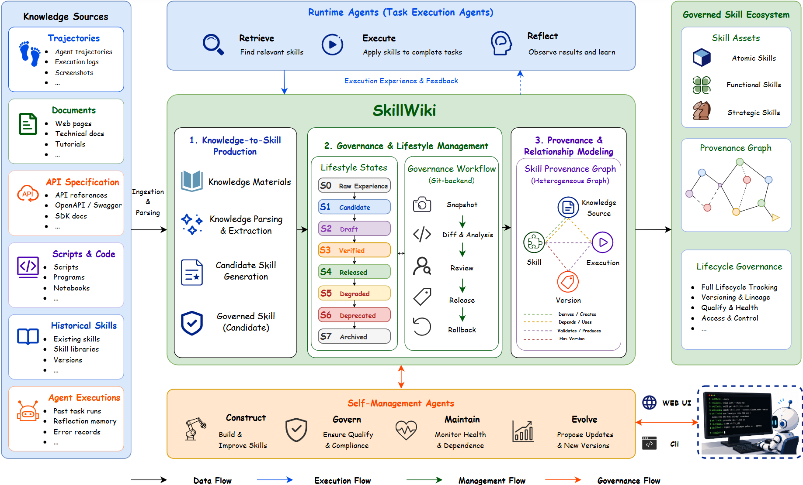

<div align="center">

# SkillWiki

**A Living Knowledge Infrastructure for Agent Skills**

Just as Wikipedia organizes human knowledge and GitHub governs software, **SkillWiki** provides the missing infrastructure for agent skills. It transforms heterogeneous knowledge sources — trajectories, documents, API specs, and execution experience — into reusable skill assets that are grounded in their originating evidence, version-controlled, and continuously evolved. SkillWiki covers the complete skill lifecycle: from knowledge ingestion and skill production, through provenance-aware graph exploration and human governance, to execution-driven health monitoring and automated evolution. The result is a shared infrastructure where knowledge, skills, and execution experience co-evolve together.

<br/>

[](LICENSE)
[](https://www.python.org/)
[](https://nodejs.org/)
[](https://github.com/Huangdingcheng/SkillWiki)


<br/>

[📺 **Demo Video (English)**](https://youtu.be/2n7n75j6v14)
&nbsp;·&nbsp;
[📺 **Demo Video (Chinese)**](https://youtu.be/HNcsK-090bU)
&nbsp;·&nbsp;
[🚀 **Live System (HF Space)**](https://huggingface.co/spaces/Huangdingcheng/SkillWiki)
&nbsp;·&nbsp;
[📖 **Paper**](https://arxiv.org/abs/2606.16523)
</div>

---

<p align="center">
  
  <br/>
  <em>SkillWiki system overview — from multi-source ingestion to governed skill evolution.</em>
</p>

---

## Key Features

| | Feature | Description |
|:---:|---|---|
| 📥 | **Multi-source ingestion** | Trajectories, documents, API specs, scripts, and existing skill JSON/JSONL files |
| 🔄 | **Governed lifecycle** | Eight-stage state machine (S0–S7) with automated verification and full audit trail |
| 🕸️ | **Provenance knowledge graph** | Typed edges — `depends_on`, `composes_with`, `evolved_from`, `replaces`, and more |
| 🩺 | **Health & evolution engine** | Continuous monitoring detects degraded skills and queues repair proposals automatically |
| 🌐 | **Bilingual UI** | English (default) and Chinese — toggle via the language button in the header |
| ⌨️ | **CLI-first** | Native commands for ingestion, verification, governance, execution and inspection |

---

## Lifecycle

```
  S0 Raw  ──►  S1 Candidate  ──►  S2 Draft  ──►  S3 Verified  ──►  S4 Released
                                                                          │
                                             S7 Archived  ◄──  S6 Deprecated  ◄──  S5 Degraded
```

| State | Name | Meaning |
|:---:|---|---|
| **S0** | Raw | Ingested source material, not yet extracted |
| **S1** | Candidate | Extracted skill candidate awaiting review |
| **S2** | Draft | Formalized schema, pending verification |
| **S3** | Verified | Passed automated postcondition checks |
| **S4** | Released | Approved for agent use in production |
| **S5** | Degraded | Success rate fell below health threshold |
| **S6** | Deprecated | Replaced or retired |
| **S7** | Archived | Read-only historical record |

---

## Quick Start

### Requirements

- Python 3.10+
- Node.js 18+ *(frontend only)*

### Install

```bash
git clone https://github.com/Huangdingcheng/SkillWiki.git
cd SkillWiki/skillwiki

python -m venv venv
source venv/bin/activate      # Linux / Mac
venv\Scripts\activate         # Windows

pip install -r requirements.txt
pip install -e ".[api]"
```

### Start the backend

```bash
skillwiki serve --port 8001 --api-key YOUR_LLM_API_KEY
```

### Start the frontend *(optional)*

```bash
cd ../skillwiki-frontend
npm install
npm run dev    # → http://localhost:3000
```

### One-click launcher (Windows)

Double-click **`START_SKILLWIKI_DEMO.bat`** in the repository root. On first run you will be prompted for your LLM endpoint and API key (saved to `skillwiki-launcher\config.local.ps1`, which is Git-ignored — never commit it).

```
Backend:  http://127.0.0.1:8001
Frontend: http://127.0.0.1:5174/wiki
```

Restore the public demo fixtures after a restart:

```
RESTORE_SKILLWIKI_DEMO_STATE.bat
```

---

## Demo Walkthrough

| Step | Page | What to explore |
|:---:|---|---|
| 1 | [`/wiki`](http://127.0.0.1:5174/wiki) | Skill library — browse, filter by state / tag, inspect schemas |
| 2 | [`/ingest`](http://127.0.0.1:5174/ingest) | Paste an API doc or upload a file; watch candidates extracted live |
| 3 | [`/graph`](http://127.0.0.1:5174/graph) | Provenance knowledge graph — Nebula, Readable, and Debug view presets |
| 4 | [`/harness`](http://127.0.0.1:5174/harness) | Execute-verify loop; observe automated repair attempts |
| 5 | [`/evaluation`](http://127.0.0.1:5174/evaluation) | SkillsBench P0 sparse-subset analysis |
| 6 | [`/versions`](http://127.0.0.1:5174/versions) | Business-readable diffs and re-verification after changes |

---

## CLI Reference

Install once after cloning:

```bash
cd skillwiki && pip install -e ".[api]"
```

Place global options before the subcommand: `skillwiki --api-url <URL> <command>`. All commands accept `--api-url <URL>` (default `http://127.0.0.1:8001`).

### Server

```bash
skillwiki serve [--host HOST] [--port PORT] [--backend git|memory]
```

### Knowledge Ingestion

```bash
# source_type: trajectory | document | api_doc | script | past_skills
skillwiki ingest run <source_type> <input> [--create]

skillwiki ingest run api_doc     ./openai_spec.md --create
skillwiki ingest run trajectory  "open browser -> search -> copy link"
skillwiki ingest run past_skills ./skills.json --max-candidates 20
skillwiki ingest status <candidate_id>
```

### Skill Lifecycle

```bash
skillwiki skill list    [--state S3] [--tag nlp] [--limit 20]
skillwiki skill get     <skill_id>   [--full]
skillwiki skill status  <skill_id>
skillwiki skill exec    <skill_id>   --input '{"key": "value"}'

skillwiki audit   <skill_id>
skillwiki verify  <skill_id>  [--harness local_skillwiki] [--max-attempts 1] [--watch]
skillwiki promote <skill_id>  <target_state>
```

### Health & Evolution

```bash
skillwiki health             [--json]   # system-wide overview
skillwiki health <skill_id>  [--json]   # success rate, issues, open proposals

skillwiki repair <skill_id>             # generate maintenance candidate
skillwiki evolve             [--json]   # run one full evolution cycle
```

### Maintenance Proposals

```bash
skillwiki proposal list    [--status pending|accepted|rejected] [--json]
skillwiki proposal accept  <proposal_id>
skillwiki proposal reject  <proposal_id>
```

### Knowledge Graph

```bash
skillwiki graph neighbors  <skill_id>  [--depth 1]
skillwiki graph show       <skill_id>  [--view skill_only|provenance|version_impact] [--depth 2]
skillwiki graph deps       <skill_id>
skillwiki graph export     <skill_id>  [-o output.json] [--view provenance] [--depth 2]
```

### Natural Language Execution

```bash
skillwiki run "summarize the attached PDF and extract action items" [--verbose]
```

---

## What SkillWiki Provides

- Knowledge-to-skill transformation from heterogeneous sources.
- Evidence-grounded skill assets with explicit provenance.
- Multi-granularity skill organization and dependency management.
- Provenance-aware exploration and visualization.
- Versioned skill governance with interpretable evolution.
- Execution-driven verification and continuous improvement.
- End-to-end demonstrations of reusable skill ecosystems.

---

## Environment Variables

| Variable | Default | Description |
|---|---|---|
| `LLM_API_KEY` | — | LLM API key *(required)* |
| `LLM_API_URL` | `https://api.deepseek.com` | LLM base URL |
| `LLM_MODEL` | `deepseek-flash` | DeepSeek V4.1 Flash API model name |
| `SKILLOS_API_TARGET` | `http://127.0.0.1:8001` | Frontend proxy target |

---

## License

[MIT](LICENSE) © 2026 SkillWiki Authors


## Native CLI workflow

The CLI calls the same API as the web UI. Install the API extra with
`pip install -e ".[api]"` from the `skillwiki` backend directory. Use
`skillwiki --help` and `skillwiki <command> --help` for the full command tree.

```bash
# Persistent Git storage, no synthetic seed data, zero LLM transport retries.
# Set LLM_API_KEY in the environment; avoid putting credentials in shell history.
skillwiki serve --backend git --storage-dir ./skillwiki-data --governance-repo ./governance --llm-retries 0
# Optional: --model MODEL --llm-api-url URL. memory is an ephemeral alternative.

# Global --api-url is the SkillWiki server, not the LLM provider endpoint.
skillwiki --api-url http://127.0.0.1:8001 skill list --tag nlp
skillwiki skill search "extract structured records" --mode lexical
skillwiki ingest run document ./source.md
# Edit the parsed draft into the native candidate-review request JSON.
skillwiki ingest audit-candidate --file candidate.json
skillwiki ingest create-candidate --file candidate.json
skillwiki audit SKILL_ID --json

# Calls the native runtime. Ingestion, auditing and verification may incur model costs.
# Default: one total attempt, no repair, no promotion. No automatic fallback.
skillwiki verify SKILL_ID --test-cases cases.json --json
# Explicit opt-ins: --allow-repair --max-attempts 3 --promote
skillwiki skill exec SKILL_ID --input '{"text":"example"}'
skillwiki execution history
skillwiki execution get EXECUTION_ID
skillwiki execution trace EXECUTION_ID
skillwiki execution experience EXECUTION_ID

# Lifecycle commands pass the native API request object unchanged.
skillwiki lifecycle new-version SKILL_ID --file version.json
skillwiki skill versions SKILL_ID
skillwiki lifecycle snapshot SKILL_ID --file snapshot.json
skillwiki lifecycle history SKILL_ID
skillwiki lifecycle diff SKILL_ID --from-ref COMMIT --to-ref HEAD
skillwiki lifecycle release SKILL_ID --file release-evidence.json
skillwiki lifecycle rollback SKILL_ID --file recovery.json
```

Request file examples (UTF-8 JSON):

- `candidate.json`: `{"source_type":"document","unit_id":"source-1","raw_content":"Return a structured result.","name":"structured_result","description":"Return a structured result.","prompt_template":"Return {\"result\":true}","prompt_format":"literal"}`.
- `cases.json`: an array of native harness cases, e.g. `[{"test_id":"case-1","name":"result present","goal":"Return the result","input_data":{},"verifier_specs":[{"type":"json_exists","path":"output.result"}]}]`.
- `version.json`: `{"bump":"patch","description":"Updated documented behavior"}`; include `interface` or `implementation` objects when changing behavior.
- `snapshot.json`: `{"author":"reviewer","message":"Review candidate snapshot"}`.
- `recovery.json`: `{"source_ref":"COMMIT","source_version":"1.0.0","reason":"Review recovery draft"}`.
- `release-evidence.json`: the complete native `EvidenceReleaseRequest` (`schema_version`, `manifest`, `traces`, `evaluation`, optional `author`); use actual identity-bound run evidence, not a copied success flag. The running server's `/docs` describes the schema.

`audit` is a non-persisting draft contract check that may use the server-configured model; it does not grant validation or
release evidence to the stored identity. `new-version` and `rollback` create
separate drafts; verify and release their new identities afresh. `promote` remains
a manual transition command, subject to server gates. Evidence-bound release uses
`lifecycle release`.

`verify` returns exit code 1 for any non-passing outcome and prints the native score
object and evidence path. Audits, skill/task execution and file-based governance
commands also return failure exits when the server reports failure. JSON output
is available on audit, verify and lifecycle/readback commands. The CLI never retries
HTTP calls; after a timeout, inspect server execution history before resubmitting.
The global `--http-timeout` controls the HTTP deadline (default 600 seconds).
`--max-retries` is retained only as an alias for **total** `--max-attempts`.
External `claude_code` and `codex_cli` adapters are explicit selections with their
own environment requirements; they are never used as native execution fallbacks.
